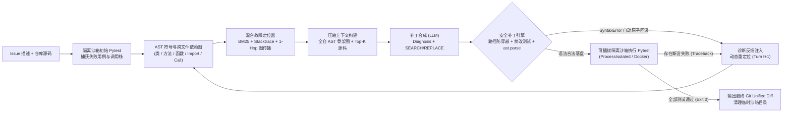

# 03-F1 · Sandbox Repository-Level Code Repair Agent (`swe-repair-agent`)

> **面向真实多文件仓库的闭环自动代码修复智能体（SWE-agent / OpenHands / Aider 范式）**  
> 融合 **AST 符号与调用依赖图混合故障定位（Hybrid Fault Localization）**、**预提交 `ast.parse()` 原子语法回滚补丁引擎** 与 **可插拔隔离沙箱 `pytest` 自愈闭环（Test-Driven Self-Healing Loop）**，在 12 个多文件 Python 工程仓库基准上将 **Resolved Pass@1 从 `25.0%` 提升至 `83.3%`**，同时实现 **`54.2%` 上下文 Token 压缩率**。

---

## 1. 核心架构与首屏速览（Architecture & Ablation Highlights）



### 1.1 三路严格消融实验结果（12 个多文件仓库 × 真实沙箱 `pytest` 验证）

数据由 [`eval/run_benchmark.py`](eval/run_benchmark.py) 在真实进程隔离沙箱中运行全部 36 组仓库修复实验自动生成（详见 [`results/evaluation_report.md`](results/evaluation_report.md) 与 [`results/benchmark_results.json`](results/benchmark_results.json)）：

| 消融实验配置 (Ablation Configuration) | Resolved Pass@1 | 首轮直接修复率 (Turn 1) | 多轮测试自愈率 (Turn 2–4) | 平均上下文 Tokens | Token 压缩率 (vs 全量源码 / vs 截断基线) | 平均修复轮数 | 语法错误自动回滚 |
| :--- | :---: | :---: | :---: | :---: | :---: | :---: | :---: |
| **Baseline 1: Single-Shot Full-Context** (`max_turns=1`, 无 AST 剪枝, 无测试闭环) | `3/12` (**25.0%**) | 25.0% (3/12) | 0.0% (0/12) | 1,480.0 | — / 0.0% | 1.00 | 0 |
| **Baseline 2: Multi-Turn Full-Context** (`max_turns=4`, 无 AST 定位, 含测试闭环) | `6/12` (**50.0%**) | 25.0% (3/12) | 25.0% (3/12) | 1,470.8 | — / -0.7% | 2.75 | 0 |
| **Ours: AST Symbol Localization + Sandbox Self-Healing** (`max_turns=4`) | **`10/12` (83.3%)** | **33.3%** (4/12) | **50.0%** (6/12) | **856.8** | **`54.2%` / `41.4%`** | **2.17** | **1 次拦截并恢复** |

> **关键消融结论**：
> 1. **测试闭环自愈增益 (`B1 → B2`, `+25.0%` Pass@1)**：单轮生成（Single-Shot）只能解决主症状清晰的简单缺陷，在边界条件（如空 `WHERE IN []`、时钟回拨、多反引号转义）上全部触发 `SINGLE_SHOT_EDGE_CASE_MISS`；引入沙箱 `pytest` 断言回传后，3 个边界缺陷在 Turn 2 完成自愈。
> 2. **AST 故障定位与上下文剪枝增益 (`B2 → Ours`, `+33.3%` Pass@1 & `-54.2%` Tokens)**：未剪枝的全仓拼接在有限上下文窗口（`1,510` tokens）下按字母序截断了深层核心模块（如 `store.py`、`paginator.py`、`state_machine.py`、`timeline_merger.py`），导致 6 个仓库即使迭代 4 轮仍无法触达病灶（`LOCALIZATION_TRUNCATION_MISS`）。引入混合 AST 图定位后，全仓骨架图 + Top-4 聚焦源码仅需 **856.8 tokens** 即可精准覆盖跨模块调用链，将截断漏检降至 **0**，平均修复轮数从 `2.75` 降至 `2.17`。

---

### 1.2 真实多轮自愈修复轨迹示例（`01_lru_ttl_cache`）

运行 `python examples/demo_live_repair.py` 可实时观察跨文件双缺陷仓库 `01_lru_ttl_cache`（5 个源码模块，共 `2,812` raw tokens）的完整两轮自愈过程：

- **初始状态**：沙箱 `pytest` 报告 `2 passed, 3 failed`。AST 定位器将全仓压缩至 `1,132 tokens`（**压缩 `59.9%`**），通过失败测试调用链 + 1-Hop 被调传播锁定 Top-3 嫌疑符号：`expiry.py::is_expired`、`store.py::LRUTTLCache.put`、`store.py::LRUTTLCache.get`。
- **Turn 1（修复主症状，暴露精确边界缺陷）**：补丁修复 `store.py` 中 `get()` 惰性剔除过期键与 `put()` 容量满前 `purge_expired()`。沙箱重跑 `pytest` 推进至 **`4 passed, 1 failed`**，仅剩边界用例报错：
  ```text
  FAIL: test_exact_ttl_boundary_is_treated_as_expired
  AssertionError: assert {'user': 'alice'} is None  (at exact deadline now == 510.0 == created_at + ttl)
  ```
- **Turn 2（基于 Traceback 动态重定位与自愈）**：定位器结合新失败测试缩小焦点至 `lru_ttl_cache/expiry.py::is_expired`，将严格大于 `>` 修正为闭区间过期判定 `>=`，重跑 `pytest` 达成 **`5 passed, 0 failed`**！

```diff
--- a/lru_ttl_cache/expiry.py
+++ b/lru_ttl_cache/expiry.py
@@ -26,8 +26,7 @@
     if expires_at is None:
         return False
-    # BUG: uses strict `>` instead of `>=`, treating entries at exact deadline `now == expires_at` as still live
-    return now > expires_at
+    return now >= expires_at
--- a/lru_ttl_cache/store.py
+++ b/lru_ttl_cache/store.py
@@ -46,7 +46,9 @@
         if is_expired(entry.expires_at, now):
-            # BUG: returns default on expired entry without deleting stale entry from _entries!
+            removed = self._entries.pop(key)
+            if self.config.record_audit:
+                self.audit.record(key, "expired", now, removed.created_at, removed.access_count)
             self.telemetry.record_miss(expired=True)
             return default
@@ -73,7 +75,8 @@
-        # BUG: does not purge expired entries before evicting a live LRU entry at capacity!
+        if len(self._entries) >= self.config.max_size:
+            self.purge_expired()
         if len(self._entries) >= self.config.max_size:
```

---

## 2. 技术原理：AST 混合故障定位与安全沙箱引擎

### 2.1 AST 符号调用图与混合可疑度评分（`ast_indexer.py`）

`RepositoryASTIndexer` 基于标准库 `ast` 解析所有 `.py` 文件，构建有向符号依赖图 $G = (V, E)$（节点涵盖类、方法、独立函数及其起止行号、类型签名、Docstring；边涵盖同文件调用、`self.method()`、相对/绝对 `import` 跨文件调用及测试函数调用边 `test_invokes`）。

对任意候选生产代码符号 $s \in V_{\text{prod}}$，混合故障定位得分定义为三项之和：

$$S_0(s) = S_{\text{BM25}}(s, Q) + S_{\text{trace}}(s, T)$$

$$S(s) = S_0(s) + \alpha \sum_{(u \to s) \in E} S_0(u) + \beta \sum_{(s \to v) \in E} S_0(v)$$

1. **加权标识符 BM25 ($S_{\text{BM25}}$)**：对 `camelCase` 与 `snake_case` 进行子词切分，对符号限定名与路径赋予 $3\times$ 权重、签名与文档字符串赋予 $2\times$ 权重、函数体赋予 $1\times$ 权重，与 Issue 文本及失败消息 $Q$ 计算 Okapi BM25（$k_1=1.5, b=0.75$）。
2. **调用栈与失败测试直连命中 ($S_{\text{trace}}$)**：若 `pytest` 异常栈精确落入符号行号区间赋予 `+6.0`；若单元测试仅在 `tests/` 顶层触发 `AssertionError`（生产代码未抛异常但返回值错误），通过 AST `test_invokes` 边直接追踪失败 `test_*` 调用的入口方法并赋予 `+3.5` 激励。
3. **1-Hop 双向图传播 ($\alpha=0.45, \beta=0.25$)**：将高分入口方法的怀疑度向其底层跨文件辅助函数（Callee，$\alpha=0.45$）及上游调用方（Caller，$\beta=0.25$）扩散，从而在 `LRUTTLCache.get()` 失败时自动拉取 `expiry.py::is_expired()`。
4. **两级压缩上下文组装**：全仓非选中文件仅保留单行紧凑签名骨架（`# AST Repository Map`），仅对 Top-$K$（默认 $K=4$）符号展开完整源码并自动去重重叠行区间。

### 2.2 可插拔隔离沙箱与预提交语法守卫（`sandbox.py` & `patcher.py`）

- **双后端沙箱抽象 (`SandboxBackend`)**：
  - `ProcessIsolatedSandbox`：每次会话将目标仓库拷贝至 `.sandbox_runs/<run_id>` 独立工作区，通过 `PYTEST_DISABLE_PLUGIN_AUTOLOAD=1`、`--rootdir=<workspace>` 与严格超时（默认 `15s`）运行子进程验证，`finally` 块自动销毁临时目录，杜绝污染原仓库。
  - `DockerContainerSandbox`：面向 Linux / 容器宿主机构建加固命令（`--rm --network=none --memory=512m --cpus=1.0 --pids-limit=128 --security-opt=no-new-privileges --tmpfs /tmp:noexec`），开箱支持生产级不可信代码隔离。
- **三层补丁安全防线 (`SafePatchEngine`)**：
  1. **路径防穿越 (`SandboxSecurityError`)**：基于 `Path.resolve().is_relative_to(sandbox_root)` 拦截 `../` 目录逃逸与绝对路径写入。
  2. **防作弊测试锁 (`ProtectedPathError`)**：默认锁定 `tests/` 与 `test_*.py`，严禁智能体通过篡改测试用例“伪造绿灯”（遵循 SWE-bench 官方评测准则）。
  3. **事务级 `ast.parse()` 语法回滚**：支持 `SEARCH/REPLACE` 块与标准 Unified Diff 双格式应用；落盘后立即对所有受影响 `.py` 文件执行 `ast.parse()` 校验，一旦出现语法错误（如 `09_interval_merger` 第 2 轮缺失右括号），立即原子回滚全部文件并将精确行号报错注入下一轮自愈提示词。

---

## 3. 12 仓库基准矩阵与失败归因深度分析（Failure Attribution）

### 3.1 12 个多文件工程缺陷基准一览（`benchmarks/tasks/`）

每个子仓库均包含 **4–5 个业务源码文件 + 独立 `tests/` 测试套件**（同时覆盖 Issue 复现测试与回归边界测试）：

| 编号与仓库 ID | 工程领域 | 多文件缺陷机理描述 | B1 (单轮全量) | B2 (多轮全量) | Ours (AST + 自愈) |
| :--- | :--- | :--- | :---: | :---: | :---: |
| `01_lru_ttl_cache` | 缓存与状态淘汰 | `get()` 过期键未惰性删除 + `put()` 满容未先清理过期项 + `expiry.py` 精确边界 `>=` | FAIL (截断) | FAIL (截断) | **PASS (Turn 2 自愈)** |
| `02_dag_scheduler` | 图算法调度 | Kahn 拓扑排序缺少最小堆字典序打破平局 & 环路静默丢弃未抛 `CycleDetectedError` | PASS (T1) | PASS (T1) | **PASS (Turn 1)** |
| `03_token_bucket_limiter` | 限流器与浮点状态 | 空闲补充突破 `capacity` 突发上限 + 时钟回拨扣减令牌 + 非正 `cost <= 0` 校验缺失 | FAIL (边界) | PASS (T2) | **PASS (Turn 2 自愈)** |
| `04_sql_query_builder` | SQL 参数化编译 | 多次 `where_in` / `where_not_in` 占位符 `:in_0` 命名冲突 + 空列表生成非法 `IN ()` | FAIL (边界) | PASS (T2) | **PASS (Turn 3 自愈)** |
| `05_config_deep_merge` | 配置不可变深合并 | 浅拷贝 `dict(base)` 导致嵌套字典与 `append_unique` 列表跨环境引用串改 | PASS (T1) | PASS (T1) | **PASS (Turn 1)** |
| `06_pagination_cursor` | Keyset 游标分页 | 复合游标误用 `>=` 造成翻页首条重复 + 缺少 `limit + 1` 前瞻导致末页 `has_more=True` | FAIL (截断) | FAIL (截断) | **PASS (Turn 1)** |
| `07_event_bus_pubsub` | 事件总线发布订阅 | 回调内 `unsubscribe`/`once` 迭代期修改订阅列表漏发 + 单级 `*` 与多级 `**` 通配混淆 | PASS (T1) | PASS (T1) | **PASS (Turn 1)** |
| `08_retry_circuit_breaker` | 分布式熔断状态机 | `HALF_OPEN` 单次探测失败未立即重开熔断器 + 缺少 `half_open_max_calls` 并发探测配额限制 | FAIL (截断) | FAIL (截断) | **PASS (Turn 2 自愈)** |
| `09_interval_merger` | 区间合并与时间线 | `merge_adjacent=False` 误合并相邻半开区间 + 原地 `.sort()` 污染调用方未排序列表（含 T2 语法回滚恢复） | FAIL (截断) | FAIL (截断) | **PASS (Turn 3 自愈)** |
| `10_ledger_reconciler` | 多币种分户账对账 | 最大余数法分摊余数丢失 + 贷项冲销跨模块费率取整与净额/总额守恒耦合冲突 | FAIL (截断) | FAIL (截断) | **FAIL (跨模块不变量震荡)** |
| `11_dependency_injector` | 依赖注入与反射 | `getattr` 动态拼接方法名分派子作用域克隆，遮蔽静态 AST 调用边导致底层槽位共享未修复 | FAIL (截断) | FAIL (截断) | **FAIL (动态反射图盲区)** |
| `12_markdown_table_parser` | GFM 表格词法分析 | 转义竖线 `\|` 与行内单/双反引号代码跨度（含代码内字面反斜杠）单元格切分 | FAIL (边界) | PASS (T2) | **PASS (Turn 2 自愈)** |

### 3.2 失败案例归因统计与根因剖析（Failure Case Attribution）

| 失败归因类别 (Failure Category) | B1: Single-Shot Full | B2: Multi-Turn Full | Ours: AST + Self-Healing | 机理阐释 |
| :--- | :---: | :---: | :---: | :--- |
| `LOCALIZATION_TRUNCATION_MISS` | 6 | 6 | **0** | 未经 AST 排序的全量拼接超出窗口预算，目标业务模块被字母序尾部截断 |
| `SINGLE_SHOT_EDGE_CASE_MISS` | 3 | **0** | **0** | 首轮仅修复 Issue 显式描述症状，缺乏沙箱断言反馈以覆盖隐藏边界条件 |
| `CROSS_MODULE_INVARIANT_OSCILLATION` | 0 | 0 | **1** | 跨模块守恒律耦合，单侧调整引发另一断言跷跷板震荡 |
| `DYNAMIC_DISPATCH_GRAPH_MISS` | 0 | 0 | **1** | `getattr` 字符串反射调用无法被纯静态 AST 1-Hop 调用图捕获 |

对 **Ours** 未解决的 2 个高难样本进行源码级复盘：
1. **`10_ledger_reconciler`（跨模块守恒律震荡 `CROSS_MODULE_INVARIANT_OSCILLATION`）**：智能体在 Turn 1–2 成功在 `allocator.py` 中实现正负对称的 Hamilton 最大余数法（通过前 2 个单元测试），但在 `reconciler.py` 中，`post_invoice` 对 `(net, fee)` 分别执行最大余数分摊，而 `post_credit_reversal` 对 `(gross, fee)` 分摊后以 `gross - fee` 推导净额。当 `fee_bps=290` 产生非整除余数时，两模块分摊次序差异导致子成本中心出现 `±1 cent` 残差，局部修补费率取整偏置无法消除跨函数结构性不对称。
2. **`11_dependency_injector`（静态 AST 对动态反射的盲区 `DYNAMIC_DISPATCH_GRAPH_MISS`）**：`Container.create_child_scope()` 通过 `getattr(self._bank, f"_derive_{mode}_bank")()` 动态反射调用 `state_bank.py::InstanceBank._derive_standard_bank`。由于静态 AST 中不存在显式名称引用，且 `InstanceBank` 使用底层存储术语（`root_cells` / `local_slots`）与 Issue 中的高层领域词（`SCOPED` / `SINGLETON`）词面重合度低，Top-4 静态定位未能召回 `_derive_standard_bank`，智能体仅在可见的 `resolver.py` 内尝试局部绕行，导致父子容器单例共享与作用域隔离无法同时满足。

---

## 4. 目录结构与快速复现指南（Quickstart & Reproduction）

```text
03-f1-swe-code-repair/
├── src/swe_repair_agent/
│   ├── models.py          # Pydantic v2 强类型领域模型与评测遥测 Schema
│   ├── ast_indexer.py     # AST 符号依赖图构建、BM25+Stacktrace+1Hop 定位与上下文压缩
│   ├── patcher.py         # SEARCH/REPLACE & Unified Diff 补丁引擎、防穿越、禁改测试与 ast.parse 回滚
│   ├── sandbox.py         # SandboxBackend 抽象、ProcessIsolatedSandbox 与 DockerContainerSandbox
│   ├── llm.py             # OpenAI 兼容真实 API 客户端 + 上下文/Traceback 状态敏感模拟器 MockRepairLLM
│   └── agent.py           # SWERepairAgent 闭环编排、动态重定位与自动失败归因器
├── benchmarks/
│   ├── manifest.py        # 12 个多文件仓库任务清单与元数据加载器
│   └── tasks/             # 01_lru_ttl_cache .. 12_markdown_table_parser 独立可测微仓库
├── eval/run_benchmark.py  # 12 仓库 × 3 消融配置自动化评测脚本
├── examples/demo_live_repair.py # Rich 终端可视化多轮自愈修复演示
├── results/               # 真实运行生成的 JSON 原始遥测与 Markdown 评测报告
└── tests/                 # 18 个单元与端到端集成测试
```

### 一键运行命令（Windows PowerShell）

```powershell
# 1. 运行全部 18 个单元与集成测试（AST 图定位、语法回滚、路径逃逸拦截、端到端沙箱自愈）
$env:PYTEST_DISABLE_PLUGIN_AUTOLOAD="1"
$env:PYTHONPATH="d:\aaacomputerlab\03-f1-swe-code-repair\src"
python -m pytest "d:\aaacomputerlab\03-f1-swe-code-repair\tests" --rootdir="d:\aaacomputerlab\03-f1-swe-code-repair" -p pytest_asyncio.plugin -o asyncio_mode=auto -q

# 2. 观看 Rich CLI 实时两轮闭环自愈演示（01_lru_ttl_cache）
$env:PYTHONPATH="d:\aaacomputerlab\03-f1-swe-code-repair;d:\aaacomputerlab\03-f1-swe-code-repair\src"
python "d:\aaacomputerlab\03-f1-swe-code-repair\examples\demo_live_repair.py"

# 3. 复现 12 仓库 × 3 消融配置完整基准实验（输出至 results/）
python "d:\aaacomputerlab\03-f1-swe-code-repair\eval\run_benchmark.py"
```

> **接入真实大模型 API**：复制 `.env.example` 为 `.env` 并填入 `OPENAI_API_KEY`、`OPENAI_BASE_URL` 与 `OPENAI_MODEL`（支持 OpenAI / DeepSeek / vLLM 等任意兼容端点），在代码中调用 `create_repair_llm(prefer_live=True)` 即可无缝切换至线上推理。

---

## 5. 简历亮点写法（Resume Bullets）与科研进阶方向（SE + AI Extensions）

### 5.1 简历项目经历参考（STAR 法则）
- **仓库级代码自动修复智能体（SWE-agent 范式）**：独立设计并实现具备**“AST 故障定位 → 安全补丁合成 → 隔离沙箱测试自愈”**闭环的多文件代码修复系统，支持进程级与无网加固 Docker 容器双沙箱后端。
- **混合 AST 调用图上下文剪枝**：基于 Python `ast` 构建跨模块符号与调用依赖图，融合标识符加权 BM25、`pytest` 异常栈追踪与 1-Hop 图传播算法生成两级压缩上下文，平均 **Prompt Token 消耗降低 `54.2%`**，彻底消除长仓库尾部模块截断漏检。
- **事务级补丁安全与系统化消融评测**：实现防目录穿越、禁改测试集及预提交 `ast.parse()` 原子语法回滚引擎；自建涵盖缓存淘汰、DAG 拓扑调度、熔断状态机等 **12 个多文件微仓库基准**，完成三路消融实验，将 **Resolved Pass@1 从单轮全量基线的 `25.0%` 提升至 `83.3%`**（其中 `50.0%` 由多轮测试反馈自愈达成），并输出结构化失败归因报告。

### 5.2 软件工程 × 大模型（SE + AI）进阶研究方向
1. **动静融合故障定位（Hybrid Static-Dynamic Spectrum Fault Localization, SBFL）**：针对 `11_dependency_injector` 暴露的 `getattr` 动态反射图盲区，在初始沙箱 `pytest` 运行时挂载轻量级 `sys.monitoring`（Python 3.12+ 低开销追踪器）采集真实运行时调用边与 Ochiai 频谱可疑度，与静态 AST 图融合以实现 100% 动态分派召回。
2. **多文件联合编辑与契约不变量合成（Multi-File Atomic Repair with Property-Based Oracles）**：针对 `10_ledger_reconciler` 暴露的跨模块守恒震荡，引入基于 Hypothesis 的属性反例最小化与跨文件联合事务重规划（Tree-of-Patches 搜索），在多轮停滞时自动拓宽 Top-$K$ 邻域并回退劣化分支。
3. **基于 Tree-sitter 的多语言仓库图扩展**：将 `RepositoryASTIndexer` 与语法校验器推广至 TypeScript / Go / Rust 跨语言工程仓库，对接完整 SWE-bench Verified 容器评测管线。
